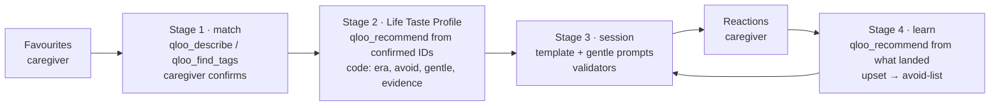

# Memory Lane — reminiscence sessions, personal to them

> Qloo Agentic Hackathon 2026 · **Live demo: https://memory-lane-sable-rho.vercel.app** · No login
> needed: tap **Try a demo profile**.

Memory Lane is an agent that prepares personalised reminiscence sessions — music, films and TV, food
and places, with gentle conversation prompts — for older adults living with memory loss. Every item
comes from Qloo's taste graph with its evidence one tap away, and the agent learns from how each
item landed.

Memory Lane supports reminiscence activities. It is not a medical device and does not diagnose or
treat any condition.

## The problem

Reminiscence and personalised music are widely used in dementia care, with evidence of small
benefits for quality of life and communication
([Cochrane review, 2018](https://www.cochranelibrary.com/cdsr/doi/10.1002/14651858.CD001120.pub3/information)).
They are delivered inconsistently
([review](https://pmc.ncbi.nlm.nih.gov/articles/PMC8132012/)), and the biggest practical barrier is
finding material that is truly personal: the songs, films and places of *this* person's youth, in
*their* culture. Generic playlists and generic AI answers are Western-centric "greatest hits".
Memory Lane removes that barrier — and is honest that it is an activity aid, not a treatment
(evidence on agitation is mixed: [trial](https://pmc.ncbi.nlm.nih.gov/articles/PMC9256757/)).

## What it does

1. **Favourites.** A caregiver adds a few public favourites (a singer, a film, a dish, a place),
   where the person grew up (town level) and anything to avoid. No personal details.
2. **Match them in Qloo.** Each favourite is looked up in Qloo; when there are several matches,
   the caregiver picks one. Nothing unconfirmed is used.
3. **Life Taste Profile.** From the confirmed Qloo IDs the agent asks Qloo what people with the same
   favourites also enjoy — singers, films and TV from the years they grew up in, places near where
   they lived, dishes — and checks every item in code.
4. **Session.** A 25-minute plan: opening song, a film or TV memory, food, a place, "your choice",
   closing song. Gentle prompts that invite, never test. Links to YouTube, Spotify or a map.
5. **It learns.** The caregiver taps how each item landed. Next time, what they sang along to comes
   first and Qloo is asked for more like it; anything that upset them never returns and joins the
   avoid-list. The plan says what changed.

## Why it needs Qloo

The interesting part isn't "an AI suggests songs" — it is that **every suggestion is a Qloo answer
for this person's actual favourites**, kept to their era, with evidence. Real results from the demo
personas (fictional people, real Qloo calls):

| Persona | Confirmed favourites | Qloo found (kept by the agent) | Session 2 learned |
|---|---|---|---|
| Harjeet, b. 1950, Amritsar → Delhi | Mohammed Rafi, Mughal-e-Azam, Sarson da saag, Sri Harmandir Sahib | Kishore Kumar, Mukesh, Lata Mangeshkar; *Guide* (1965), *Deewaar* (1975); Amritsari kulcha; Gobindgarh Fort, Sadda Pind | Asha Bhosle, Hemant Kumar (from Rafi & Mukesh); *Mera Naam Joker*, *Padosan* (from Mughal-e-Azam) |
| Margaret, b. 1944, Liverpool → Manchester | Cilla Black, The Beatles, Coronation Street, Fish and chips, The Blackpool Tower | The Kinks, Tom Jones, Roy Orbison; *Upstairs, Downstairs* (1971); Haydock Park, Theatre Royal | Gene Pitney, Sandie Shaw (from Cilla Black); *Emmerdale Farm*, *Brookside* (from Coronation Street) |
| Dorothy, b. 1946, Dayton → Columbus | Patsy Cline, The Sound of Music, Elvis Presley, I Love Lucy, Pot roast | Roy Orbison, Harry Belafonte, The Platters; *Out of Africa*, *The Waltons*; Carillon Historical Park, Packard Museum | Dion, Del Shannon (from Patsy Cline & Roy Orbison); *Mary Poppins*, *My Fair Lady* (from The Sound of Music) |

The avoid-list is absolute, and Qloo's own descriptions make it work: for Dorothy, a group whose
Qloo description mentions "Unchained Melody" (on her avoid-list) was left out; for Harjeet, an
avoid entry "Partition" also keeps out a border-ceremony landmark whose description never says the
word.

## How the agent works



**Qloo decides, code verifies.** The plan of each stage is fixed and visible (the live log shows
each step); the agentic part is what Qloo answers and how the agent adapts:

| Qloo tool (via `qloo mcp`) | Used for | Why it fits |
|---|---|---|
| `qloo_describe` | Stage 1: singers, films, TV, places | Resolves a typed name to a Qloo entity; several matches → the caregiver chooses (one option per real place listing) |
| `qloo_find_tags` | Stage 1 dishes/interests; Stage 2 "<town> food" | Dishes are tags in Qloo, not entities ("Butter chicken" as an entity is a restaurant) |
| `qloo_recommend` (`explain`) | Stage 2 artists, films, TV, places (`filter_location`); Stage 4 neighbours of what landed | "People who enjoy X also enjoy Y" from exact entity IDs; Qloo's explanation names which favourites contributed, and that becomes the caption |

Code around Qloo (because Phase 0 showed what Qloo can't do — [findings](docs/qloo-findings.md)):
no year filter exists, so films/TV are kept to birth +5 … +45 by `release_year` and singers are
ordered by the decades Qloo's descriptions mention; places are kept only when Qloo's description
opens with a lasting landmark (not a hotel or bar) in the same country; the avoid-list reads Qloo's
full descriptions; a gentle filter leaves out atrocities, suicide and abuse.

### Redacted request → result example

How one request became session items (request shape and names only; IDs and payloads are not
stored in this public repo, per Qloo's developer guide):

1. **Entity choice.** Stage 1 sent `qloo_describe {entity: "Mohammed Rafi", type: "artist"}` → status
   `ok`, exact match "Mohammed Rafi" (artist). The caregiver confirmed it; its Qloo ID is stored.
2. **Tag choice.** `qloo_find_tags {query: "Sarson da saag"}` → five dish tags; the agent kept the ones
   sharing a real word with the favourite ("Sarson Da Saag", "Sarson Ka Saag", "Saag"), preferring the
   cuisine tag; the caregiver chose "Sarson Da Saag".
3. **Recommendation.** Stage 2 sent
   `qloo_recommend {target_type: "artist", signals: ["<Mohammed Rafi id>", "<Mughal-e-Azam id>"], limit: 20, explain: true}`
   → status `ok`, 20 results led by Lata Mangeshkar, Kishore Kumar, Asha Bhosle, Mukesh, Manna Dey.
4. **Checks.** Code put singers whose descriptions centre in the 1960s–70s first, dropped mostly-later
   voices, checked the avoid-list and the evidence record, and wrote the caption from Qloo's
   explanation: *"People who enjoy Mughal-E-Azam and Mohammed Rafi often also enjoy Kishore Kumar."*
5. **Session.** Kishore Kumar became a session item with a YouTube search link and prompts such as
   *"Where did music like this play when you were young: the radio, the cinema, a wedding?"* The
   evidence drawer shows the recorded call (tool, what was asked, status, result count, time).

## Responsible by design

- **No personal data to Qloo.** A guard in front of every call refuses nicknames (with variants),
  contact details, addresses and health terms; places stay at town level; only confirmed-seed Qloo
  IDs the server vouches for pass as IDs.
- **Aggregate wording.** Captions describe what groups enjoy, never what this person will like.
  Validators block claims about the person and any treatment wording; prompts are never memory tests.
- **Honest states.** No Qloo key, quota or outage → the app says so; it never invents items. A build
  that couldn't reach Qloo never replaces a good version.
- **Data.** No login (an owner token on the device); "Delete this profile" removes everything,
  including Qloo call records; idle profiles go after 90 days. Shared-quota protection: per-device
  and per-IP allowances, one research run per profile, part of the budget kept for the demos.

## Run it yourself

Prerequisites: Node ≥ 22.19, pnpm 12, and the Qloo harness.

```sh
npm install --global @qloo/qloo-harness   # provides `qloo mcp`
export QLOO_BASE_URL=https://hackathon.api.qloo.com          # hackathon keys only work here
export QLOO_TRUSTED_BASE_URL=https://hackathon.api.qloo.com
qloo setup --qloo                          # type your own key here (Windows PowerShell: qloo.cmd)
pnpm install
cp .env.example .env                       # DATABASE_URL optional: use DATABASE_URL=pglite:memory
pnpm dev                                   # web on :3000, agent on :8787
```

- **Without a database:** `DATABASE_URL=pglite:memory` runs an in-process Postgres (data is lost on
  restart). Add `SEED_DEMOS=1` to build the three demo personas locally (about 36 Qloo calls once).
- **Without a Qloo key:** `pnpm --filter @memory-lane/agent dev:fixtures` uses synthetic Qloo answers
  ("Example Artist A"), so the whole flow can be clicked through. Both dev switches are refused in
  production.
- Checks: `pnpm test` (Vitest on synthetic envelopes, no live calls) · `pnpm typecheck` ·
  `pnpm lint` · `pnpm build`.

Deployed as: Next.js on Vercel (`apps/web`), the agent in a Docker container on Render (`apps/agent`,
`render.yaml`; Qloo calls only from here, through `qloo mcp`), Postgres on Neon.

| Path | What |
|---|---|
| `apps/web` | Next.js 16 (App Router), Tailwind 4, accessible components |
| `apps/agent` | Fastify 5 agent: Qloo gateway (`qloo/`), stages 1–4 (`stage1/`…`stage4/`), demo seeder |
| `packages/shared` | zod schemas shared by web and agent (single source of truth) |
| `docs/` | Spec, architecture, agent design, safety, Qloo findings, build log |

## Known limitations

- Qloo results describe what groups of people tend to enjoy; they don't establish what one person
  remembers or will enjoy, and Memory Lane makes no claim of clinical benefit.
- No decade filter in Qloo: era fit comes from release years (films/TV) and description dates
  (singers), which is good but not perfect (a modern singer without dates can slip in).
- Food is lighter than music: dishes are tags in Qloo without years or places.
- Places near a town are mostly modern venues in Qloo; only lasting landmarks are kept, so some
  towns get few places.
- The Claude-based steps (proposing era-typical names for Qloo to rank, warmer item-specific
  prompts, a side-by-side "generic AI vs Qloo" comparison) are designed (docs/05) but not switched on
  yet; every step shown works without an LLM, so nothing depends on a model inventing items.
- Profiles live on one device (no accounts); favourites can't be edited after creating a profile.

## Notes for Qloo

Phase 0 findings are in [docs/qloo-findings.md](docs/qloo-findings.md): artist → artist recommends
are wonderfully era-faithful; a decade/release-year filter for `qloo_recommend` would remove most of
our era code; `demographic` age bands above 55 are dropped; `where_popular` returns only geohash
cells; places near a town are dominated by hotels and venues.

## Author · License

Built by Ajit Singh Rawat, solo, with Claude Code. MIT — see [LICENSE](LICENSE).
