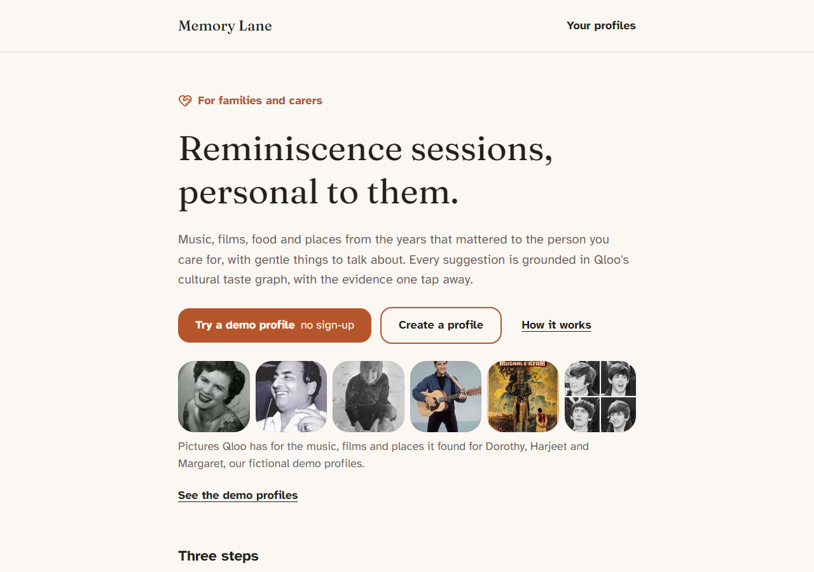
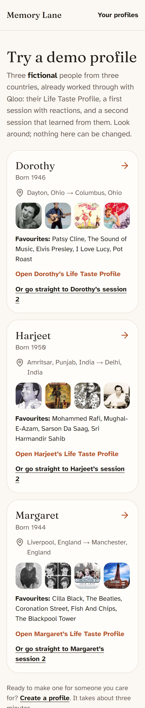
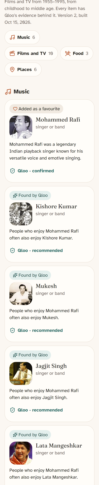
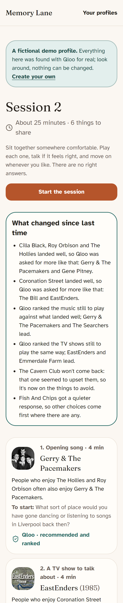
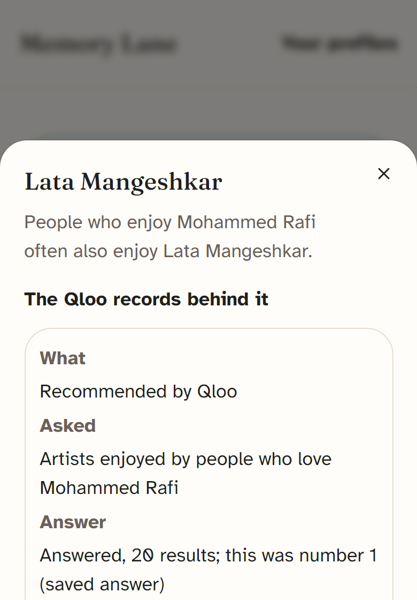
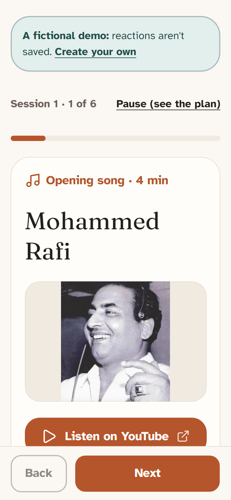
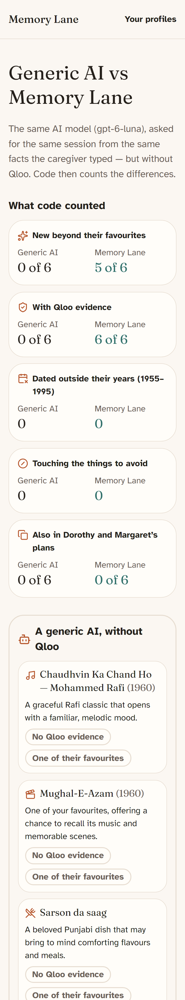
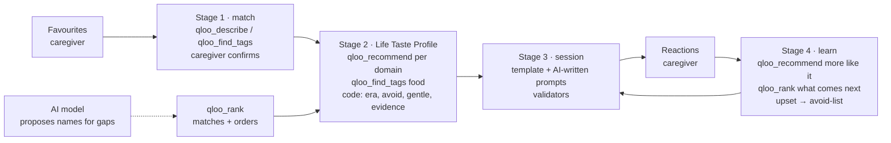

# Memory Lane — reminiscence sessions, personal to them

> Qloo Agentic Hackathon 2026 · **Live demo: https://memory-lane-sable-rho.vercel.app** · No login
> needed: tap **Try a demo profile**.



Memory Lane is an agent that prepares personalised reminiscence sessions — music, films and TV, food
and places, with gentle conversation prompts — for older adults living with memory loss. Every item
comes from Qloo's taste graph with its evidence one tap away, and Qloo decides what comes next as the
agent learns from how each item landed.

Memory Lane supports reminiscence activities. It is not a medical device and does not diagnose or
treat any condition.

## Try it in 60 seconds

1. Open the [live demo](https://memory-lane-sable-rho.vercel.app/demo) and pick **Margaret** (Liverpool),
   **Harjeet** (Amritsar) or **Dorothy** (Dayton). They are fictional; everything they show was found
   with Qloo for real.
2. Tap **Open session 2: what it learned from session 1**. Read **What changed since last time**: Qloo
   was asked for more like what landed, ranked what is still to play, and the item that upset them is
   gone.
3. Tap any green **Qloo ·** chip: the exact Qloo calls behind that item (what was asked, with the
   favourites by name, what Qloo answered and where this item sat in the answer).
4. Tap **Generic AI vs Memory Lane**: the same AI model given the same facts and task without Qloo,
   next to Memory Lane's session 1, with the differences counted in code.
5. Run the learning loop yourself: **Try the learning yourself** makes a private copy on your device.
   Play session 1, tap how each item lands, finish, then **Plan the next session** — the agent asks
   Qloo live and explains what it changed.

## The problem

Reminiscence and personalised music are widely used in dementia care, with evidence of small benefits
for quality of life and communication
([Cochrane review, 2018](https://www.cochranelibrary.com/cdsr/doi/10.1002/14651858.CD001120.pub3/information)).
They are delivered inconsistently ([review](https://pmc.ncbi.nlm.nih.gov/articles/PMC8132012/)), and the
biggest practical barrier is finding material that is truly personal: the songs, films and places of
*this* person's youth, in *their* culture. Generic playlists drift to Western-centric "greatest
hits", and a generic AI answer can't show why an item fits or check it. Memory Lane removes that barrier, and is honest that it is an activity
aid, not a treatment (evidence on agitation is mixed:
[trial](https://pmc.ncbi.nlm.nih.gov/articles/PMC9256757/)).

## What it does

1. **Favourites.** A caregiver adds a few public favourites (a singer, a film, a dish, a place), where
   the person grew up (town level) and anything to avoid. No personal details.
2. **Match them in Qloo.** Each favourite is looked up in Qloo; when there are several matches, the
   caregiver picks one (with Qloo's picture of the best match: "yes, that's him"). Nothing unconfirmed
   is used.
3. **Life Taste Profile.** From the confirmed Qloo IDs the agent asks Qloo, domain by domain, what people
   with the same favourites also enjoy: singers from the singers they love, films and TV from their
   films and shows, places in and around where they grew up, dishes from Qloo's food tags. Code keeps
   it to their era, gentle and on-topic, and checks every item. The agent's own step log is saved and
   shown as **How Memory Lane built this**, including what it left out and why; when too few films
   fit their years it asks Qloo again from the ones that do. When Qloo leaves a gap (no TV from their
   years), an AI model proposes era-typical names, Qloo matches and ranks them, and code checks their
   years: for Harjeet the AI suggested *Hum Log*, *Malgudi Days* and others, and Qloo matched and
   ranked *Malgudi Days* (1986) and *Flop Show* (1989). When Qloo knows several shows by one name
   ("Ramayan" 1987, 2008…), the agent picks the one from their years.
4. **Session.** A 25-minute plan: opening song, a film or TV memory, food, a place, "your choice",
   closing song. At most two favourites open it as familiar anchors; the rest is what Qloo found.
   Items show Qloo's own picture (the singer, the film poster, the place) to look at together; dishes
   keep their icon.
   Gentle, item-specific prompts written by the AI from Qloo's description of each item and checked
   like everything else (spoken to the person, invite, never test; no memory words; the avoid-list).
   Links to YouTube, Spotify or Google Maps. Printable for a care-home folder.
5. **It learns, and Qloo decides what's next.** The caregiver taps how each item landed. Next time,
   Qloo is asked for more like what they sang along to, **`qloo_rank` orders everything still to play
   against it**, anything that upset them never returns and joins the avoid-list, and the plan says
   what changed.

| | | |
|---|---|---|
|  |  |  |
| Demo personas, each with Qloo's pictures from their profile | Harjeet's Life Taste Profile: Qloo's picture and evidence on every card | Margaret's session 2: what it learned |
|  |  |  |
| The evidence drawer: the Qloo calls behind an item | The player: the name, Qloo's picture to look at together, one hand | The same AI without Qloo, counted in code |

## Why it needs Qloo

The interesting part isn't "an AI suggests songs": **every suggestion is a Qloo answer for this
person's actual favourites**, kept to their era, with evidence, and Qloo's ranking decides the order of
the next session. The live demo personas (fictional people, real Qloo calls; Stage 1 takes each
favourite's first match, as a caregiver would) show it — open them for the full lists and evidence:

| Persona | Confirmed favourites (caregiver input) | Found with Qloo | Session 2 |
|---|---|---|---|
| Harjeet, b. 1950, Amritsar → Delhi | Mohammed Rafi, Mughal-e-Azam, Sarson da saag, Sri Harmandir Sahib | 5 singers; 5 Hindi films from 1955–1995 (3 from the agent's second look, e.g. *Sholay*); 2 TV classics the AI proposed and Qloo matched (*Malgudi Days*, 1986; *Flop Show*, 1989); 2 dishes; 5 places (gurdwaras, a fort) | 2 films learned (*Padosan*, *My Name Is Joker*); opens with Qloo's top-ranked singer (Lata Mangeshkar) |
| Margaret, b. 1944, Liverpool → Manchester | Cilla Black, The Beatles, Coronation Street, Fish and chips, The Blackpool Tower | 4 singers (e.g. The Searchers); 5 British-led films and TV (e.g. *Brookside*); 5 places (e.g. The Cavern Club); no dishes (Qloo's Liverpool food tags were restaurant styles, and the profile says so) | 2 singers (Gerry & The Pacemakers, Gene Pitney) and 2 TV dramas learned (*EastEnders*, *The Bill*); the upsetting place never returns |
| Dorothy, b. 1946, Dayton → Columbus | Patsy Cline, The Sound of Music, Elvis Presley, I Love Lucy, Pot roast | 4 singers; 4 films and TV from 1951–1991; 3 Ohio dishes (e.g. Buckeye); 5 Dayton landmarks | 2 singers (Eddie Cochran, Dion) and 2 musicals learned (*Mary Poppins*, *My Fair Lady*); the upsetting place never returns |

**The same AI, without Qloo:** given the same facts, the same task (a favourite or two, then new
things) and the same wording rules, the model makes a reasonable plan: 4–5 of 6 items beyond the
favourites for the three demo people (Memory Lane's session 1: 3–4). What it can't do is show why:
**0 of 6 items with Qloo evidence, against 6 of 6**, and nothing checks its years (one of its songs for
Harjeet is from 1949, before his years). Every Memory Lane item is Qloo's answer for people with the
same favourites, inside their years and checked against the avoid-list. The counts are made in code
on the **Generic AI vs Memory Lane** page of each demo profile.

**Specific to each person, not "greatest hits":** across the three personas the agent kept 73 items, 71
of them distinct; only 2 appear for two people (Roy Orbison and the TV drama *Family*, both US/UK),
and none is shared with the India persona. Asking each domain with its own favourites matters: with all of Margaret's favourites at once,
Qloo suggested American dramas; with Coronation Street and Cilla Black it suggests British soaps, and
her singers near Liverpool find the city's music landmarks. The avoid-list is absolute and reads Qloo's
own descriptions, with related words for well-known painful topics (an entry "Partition" also covers
the border, 1947 and refugees), so a suggestion whose description touches the topic is left out even
when its name doesn't.

## How the agent works



**Qloo decides, code verifies.** Each stage's plan is fixed and visible (the live log and the saved
build steps show every step); the agentic part is what Qloo answers and how the agent adapts:

| Qloo tool (via `qloo mcp`) | Used for | Why it fits |
|---|---|---|
| `qloo_describe` | Stage 1: singers, films, TV, places | Resolves a typed name to a Qloo entity; several matches → the caregiver chooses (one option per real place listing) |
| `qloo_find_tags` | Stage 1 dishes/interests; Stage 2 "<town> food" and "<region> food" | Dishes are tags in Qloo, not entities ("Butter chicken" as an entity is a restaurant) |
| `qloo_recommend` (`explain`) | Stage 2: singers from singers, films/TV from films and shows, places twice (from tastes and from a loved place, `filter_location`); Stage 4: more like what landed | "People who enjoy X also enjoy Y" from exact entity IDs; Qloo's explanation names which favourites contributed, and that becomes the caption |
| `qloo_rank` | Stage 4: what is still to play (≤10 options) ranked against what landed; Stage 2: the AI's proposed names for a gap (an ambiguous title resolved to the one from their years) | Qloo, not code or the AI, decides the order of the next session and whether a proposal counts; the rank call joins each item's evidence |

The AI model (OpenAI `gpt-6-luna` through any OpenAI-compatible API, server-side) never decides
what's in a session: it proposes names for gaps (they count only once Qloo matches and ranks them and
their years fit), writes prompts for items already chosen (each passes the same checks as the
built-in ones, plus the avoid-list), and plays the "generic AI" in the comparison. It receives public
facts only (their years, town-level places, favourites' names, avoid topics without reasons), never
the nickname or notes; answers are cached, and live calls are capped per day, per device and per
network. Without a key the app runs on Qloo and code alone, and says so.

Code around Qloo (Phase 0 showed what Qloo can't do — [findings](docs/qloo-findings.md)): no year
filter exists, so films/TV are kept to birth +5 … +45 by `release_year` and singers are ordered by the
decades Qloo's descriptions mention; places are kept only when Qloo's description opens with a lasting
landmark (not a hotel, bar or new venue) in the same country; dishes are named dishes only (restaurant
styles and "Punjabi"-style labels are left out, variants merged); the avoid-list reads Qloo's full
descriptions; a gentle filter leaves out atrocities, suicide, abuse, hospital dramas and horror. Song
searches add the decade they are remembered for; map searches add the town.

### Redacted request → result example

How requests became session items for Harjeet (request shape and a few names only; IDs, payloads and
full result lists are not stored in this public repo, per Qloo's developer guide):

1. **Entity choice.** Stage 1 sent `qloo_describe {entity: "Mohammed Rafi", type: "artist"}` → status
   `ok`, exact match "Mohammed Rafi" (artist). The demo takes the first match; a caregiver confirms it
   on the confirm screen. Its Qloo ID is stored.
2. **Tag choice.** `qloo_find_tags {query: "Sarson da saag"}` → dish tags; the agent kept the ones
   sharing a real word with the favourite; the first, Qloo's popular-food-item tag "Sarson Da Saag",
   was chosen.
3. **Recommendation.** Stage 2 sent `qloo_recommend {target_type: "artist", signals: ["<Mohammed Rafi
   id>"], limit: 20, explain: true}` → status `ok`, 20 results including Kishore Kumar, Mukesh and Lata
   Mangeshkar. Code put singers whose descriptions centre in their era first, checked the avoid-list
   and the evidence record, and wrote the caption from Qloo's explanation: *"People who enjoy Mohammed
   Rafi often also enjoy Kishore Kumar."* Only two films fitted his years, so the agent asked Qloo again
   from those two and kept three more from 1957–1975.
4. **Learning.** In session 1, the opening and closing songs got "Sang along". Stage 4 sent
   `qloo_recommend {target_type: "artist", signals: [<the two singers that landed>], limit: 15}` and kept
   only voices Qloo's descriptions date to his years (none new this time, so none were added; the films
   that landed brought two more films), then `qloo_rank {option_type: "artist", options: [<the singers
   still to play>], signals: [<what landed>]}` ordered the rest.
5. **Session.** Session 2 opens with Qloo's top-ranked singer, Lata Mangeshkar, with a YouTube search
   that adds the decade she is remembered for and AI-written prompts such as *"Tell me about a singer
   whose voice you liked hearing on the radio back then."* Its evidence drawer shows both the recommend
   and the rank calls.

## Responsible by design

- **No personal data to Qloo.** A guard in front of every call refuses nicknames (with variants),
  contact details, addresses and health terms; places stay at town level; only Qloo IDs the server
  read from its own records pass as IDs. The AI model gets the same public facts only, behind the
  same guard. The caregiver's notes never leave Memory Lane and refuse health or contact details.
- **Aggregate wording.** Captions describe what groups enjoy, never what this person will like.
  Validators block claims about the person and any treatment wording; prompts are never memory tests.
- **No songs, films or lyrics hosted.** Songs and films open as YouTube or Spotify searches, places as
  map searches. Pictures are Qloo's own image URLs, resized and cached by Vercel's image optimizer and
  served from our site; only the URL is stored, and no image is committed.
- **Honest states.** No Qloo key, quota or outage → the app says so (and points to the demos); it never
  invents items. A build that couldn't reach Qloo never replaces a good version.
- **Data.** No login (an owner token on the device); "Delete this profile" removes the profile, its
  sessions and its Qloo call records; idle profiles go after 90 days. Shared-quota protection:
  per-device and per-IP allowances, one research run per profile, part of the budget kept for the
  demos, at most 50 sessions per profile. Demo personas can't be changed by any request.

## Run it yourself

Prerequisites: Node ≥ 22.19, pnpm 12, and the Qloo harness.

```sh
npm install --global @qloo/qloo-harness   # provides `qloo mcp`
export QLOO_BASE_URL=https://hackathon.api.qloo.com          # hackathon keys only work here
export QLOO_TRUSTED_BASE_URL=https://hackathon.api.qloo.com
qloo setup --qloo                          # type your own key here (Windows PowerShell: qloo.cmd)
pnpm install
cp .env.example .env                       # DATABASE_URL optional: use DATABASE_URL=pglite:memory
pnpm dev                                   # web on :3000, agent on :8787
```

- **Without a database:** `DATABASE_URL=pglite:memory` runs an in-process Postgres (data is lost on
  restart). Add `SEED_DEMOS=1` to build the three demo personas locally (about 50 Qloo calls once).
- **AI steps (optional):** set `LLM_API_KEY` (any OpenAI-compatible API; `LLM_MODEL` defaults to
  `gpt-6-luna`, `LLM_BASE_URL` to OpenAI). Without it the app runs on Qloo and code alone.
- **Without a Qloo key:** `pnpm --filter @memory-lane/agent dev:fixtures` uses synthetic Qloo answers
  ("Example Artist A"), so the whole flow can be clicked through. Both dev switches are refused in
  production.
- Checks: `pnpm test` (Vitest on synthetic envelopes and a fake AI, no live calls; 187 tests) · `pnpm typecheck` ·
  `pnpm lint` · `pnpm build`.

Deployed as: Next.js on Vercel (`apps/web`), the agent in a Docker container on Render (`apps/agent`,
`render.yaml`; Qloo calls only from here, through `qloo mcp`), Postgres on Neon.

| Path | What |
|---|---|
| `apps/web` | Next.js 16 (App Router), Tailwind 4, accessible components |
| `apps/agent` | Fastify 5 agent: Qloo gateway (`qloo/`), stages 1–4 (`stage1/`…`stage4/`), demo seeder |
| `packages/shared` | zod schemas shared by web and agent (single source of truth) |
| `docs/` | Spec, architecture, agent design, safety, Qloo findings, build log |

## Known limitations

- Qloo results describe what groups of people tend to enjoy; they don't establish what one person
  remembers or will enjoy, and Memory Lane makes no claim of clinical benefit.
- No decade filter in Qloo: era fit comes from release years (films/TV) and description dates
  (singers), which is good but not perfect (a later singer with dates near the edge can slip in, and
  Qloo's ranking then puts them last).
- Food is lighter than music: dishes are tags in Qloo without years, and for some towns Qloo's food tags
  are restaurant styles only (the profile then says so and uses the favourite dishes).
- Places near a town are mostly modern venues in Qloo; only lasting landmarks are kept, so some towns
  get few places.
- The AI-written prompts are only as good as Qloo's one-line description of each item; they are
  checked for tone, not for facts beyond that line, and an item keeps its template prompts when the
  model's don't pass. The comparison uses one model run per profile (cached), not an average.
- Profiles live on one device (no accounts); favourites can't be edited after creating a profile.

## Business model & what's next

Dementia is common and growing: 57 million people were living with dementia worldwide in 2021, with
nearly 10 million new cases every year ([WHO](https://www.who.int/news-room/fact-sheets/detail/dementia)).
Reminiscence is part of everyday care, but preparing it person by person is the hard part.

- **Care homes and day centres (the buyer):** per-resident monthly subscription; printable session plans,
  a coordinator view across residents, and activity records for care-quality reporting.
- **Families:** free tier with a few sessions a month; paid tier for unlimited sessions and sharing with
  siblings or carers.
- **Channels:** dementia-care associations, care-home groups, memory cafés.
- **Next:** multilingual prompts (Hindi and Punjabi for the India persona), a coordinator dashboard,
  accounts with device transfer, and pilots with care homes.

## Notes for Qloo

Phase 0 findings are in [docs/qloo-findings.md](docs/qloo-findings.md): artist → artist recommends are
wonderfully era-faithful; `qloo_rank` cleanly separates era names from later ones; a decade/release-year
filter for `qloo_recommend` would remove most of our era code; `demographic` age bands above 55 are
dropped; `where_popular` returns only geohash cells; places near a town are dominated by hotels and
venues, and food tags near a town are mostly restaurant styles.

## Author · License

Built by Ajit Singh Rawat, solo, with Claude Code. MIT — see [LICENSE](LICENSE).
