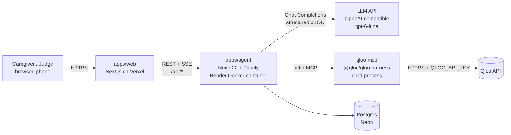

# 04 · Architecture & Tech Stack

## 1. System diagram

- Browser **never** talks to Qloo or the LLM directly. Keys live only in the agent container. Qloo's
  item pictures (`images.qloo.com/i/…`, allow-listed in `packages/shared/src/image.ts`) are loaded by the
  web app's image optimizer on Vercel and served from our own origin, so the browser doesn't contact Qloo
  for them either; they are resized and cached by Vercel's image optimizer for up to 31 days and served from our site; only the URL is stored in our database; never committed.
- Frontend calls agent service via `NEXT_PUBLIC_AGENT_URL`; agent restricts CORS to the web origin.

## 2. Tech stack (use latest stable versions at scaffold time; pin in lockfile)
| Layer | Choice | Why |
|---|---|---|
| Monorepo | pnpm workspaces (plain `pnpm -r` scripts, no Turborepo) | shared types, one repo for judges |
| Language | TypeScript strict everywhere | fewer bugs, shared types |
| Frontend | Next.js (App Router), React, Tailwind CSS, shadcn/ui (Radix), lucide icons | fast, accessible components |
| Forms/validation | react-hook-form + zod | shared zod schemas with backend |
| Data fetching | `fetch` + a small SSE reader (`lib/sse.ts`) | streaming agent progress; EventSource can't POST or send the bearer header |
| Backend | Node ≥ 22.19, Fastify, zod; built with tsup into one self-contained `dist/server.cjs` | light, fast, long-lived process for MCP; tiny runtime image |
| Qloo | `@qloo/qloo-harness` (global in container) + `@modelcontextprotocol/sdk` client | official route |
| LLM | Any OpenAI-compatible Chat Completions API via plain `fetch` (`llm/client.ts`): structured JSON output, reasoning effort low; default OpenAI `gpt-6-luna` ($0.10 / $0.50 per 1M tokens) | the developer's existing key; cheap, fast, structured outputs; Gemini/Groq work through `LLM_BASE_URL` |
| DB | Postgres + Drizzle ORM + drizzle-kit migrations | simple, typed |
| Cache | Postgres table `qloo_cache` (no Redis needed) | fewer moving parts |
| Rate limit | `@fastify/rate-limit` + DB daily budget counter | quota safety |
| Testing | Vitest (unit) with synthetic Qloo envelopes (committed) + locally recorded fixtures (gitignored — no Qloo response data in the public repo); store SQL tested on PGlite (in-process Postgres) with the real migrations; Playwright (2–3 e2e smoke flows) | reliability |
| Migrations | drizzle-kit generates SQL into `apps/agent/drizzle/` (`db:generate`); the agent applies them at startup (failure is logged by code, agent keeps serving) | no manual DB steps on deploy |
| Lint/format | ESLint + Prettier | consistency |
| CI | GitHub Actions: typecheck, lint, test | judges see quality |
| Hosting | Vercel (web), **Render free** (agent, `apps/agent/Dockerfile` via `render.yaml`), **Neon free** (DB); all US East | MCP needs a container; all free. Render free sleeps after 15 min idle → UptimeRobot 5-min keep-alive on `/api/health/live` (750 free h/month covers 24/7; touches no DB). Readiness monitor on `/api/health` only **hourly**, because Neon free has ~100 CU-h/month and a 5-min DB ping would keep it awake 24/7 |
| Observability | pino logs (redacted), simple `/api/health` | debugging |

**Note:** Claude Code pays for *building*. The deployed app's own LLM calls use the developer's
OpenAI API key (`LLM_API_KEY` on Render; a $5 monthly limit in the OpenAI dashboard). Calls are
cached by input hash in `llm_calls` and capped per day (`LLM_DAILY_CALLS`, default 400); without a key
the LLM steps are switched off and say so.

## 3. Repo layout
```
memory-lane/
├─ CLAUDE.md                  # master rules for Claude Code
├─ README.md                  # judge-facing (template in docs/10)
├─ LICENSE                    # MIT
├─ .mcp.json                  # Claude Code dev access to `qloo mcp` (no secrets)
├─ .claude/agents/*.md        # project subagents
├─ .env.example
├─ docs/                      # this pack + qloo-findings.md + progress.md
├─ apps/
│  ├─ web/                    # Next.js
│  │  └─ src/app/{page,demo,profiles/new,profiles/[id],sessions/[id],compare/[id],how-it-works}
│  └─ agent/
│     ├─ Dockerfile           # node:22 + npm i -g @qloo/qloo-harness (build context = repo root)
│     └─ src/
│        ├─ server.ts         # Fastify routes
│        ├─ qloo/{mcpClient,gateway,redact,cache}.ts
│        ├─ agent/{orchestrator,prompts,tools,validators,baseline}.ts
│        ├─ db/{schema,client,migrations}
│        └─ seed/demoPersonas.ts
└─ packages/shared/src/{schemas,types}.ts   # zod schemas = single source of truth
```

## 4. Data model (Drizzle / Postgres)
| Table | Key columns |
|---|---|
| `profiles` | id (uuid), owner_token_hash (sha256 of the device's owner token), nickname, birth_year, languages[], life_stages jsonb [{region, from_year, to_year}], is_demo bool, created_at |
| `seeds` | id, profile_id, raw_text, domain (music/film/tv/food/place/other), qloo_entity_id, qloo_entity_type, display_name, year, description, image_url (Qloo's picture of the chosen match, allow-listed), status (pending/needs_input/confirmed/rejected/unresolved, CHECK), note (not_found/no_clear_match/personal_info/invalid/lookup_failed: why it wasn't matched, shown as fixed text), source (caregiver/learned), evidence_id (FK → qloo_calls; CHECK: confirmed ⇒ evidence_id + qloo_entity_id) |
| `seed_candidates` | seed_id (cascade), position, entity_id, name, entity_type (raw Qloo type URN), year, description (one line from Qloo), image_url (Qloo's picture of the best match, allow-listed), evidence_id (not null, FK → qloo_calls): the matches Stage 1 found; confirm only accepts one of these, then the seed's candidates are deleted |
| `avoid_items` | id, profile_id, text, qloo_entity_id nullable, reason, source (caregiver/learned) |
| `taste_profiles` | id, profile_id (cascade), version (unique per profile; the newest is shown), era_from, era_to, partial, items jsonb (`TasteItemSchema`: domain, entityId, entityType URN, typeLabel, name, year, description, caption, source favourite/qloo/proposed/learned, becauseOf[], evidenceIds[], locality?, image? (Qloo's picture URL)), notes jsonb, created_at |
| `sessions` | id, profile_id (cascade), number (unique per profile), status (planned/in_progress/done, CHECK), taste_profile_id (set null), what_changed jsonb, created_at |
| `session_items` | id, session_id (cascade), position, kind (song/film/tv/food/place), domain, entity_id, entity_type, name, year, why, prompts text[], minutes, link jsonb, alt_link jsonb, evidence_ids text[] (CHECK non-empty), image_url (Qloo's picture, allow-listed), reaction (sang/engaged/neutral/distressed, CHECK), note (the caregiver's words; never sent to Qloo), reacted_at |
| `qloo_calls` | id, profile_id nullable (cascade on profile delete), tool, args_checked jsonb (as sent, after the PII guard), status, summary, result_count, results_digest jsonb, cached bool, latency_ms, created_at |
| `qloo_cache` | key (sha256), tool, args jsonb, envelope jsonb, expires_at |
| `budget` | day, qloo_calls, llm_tokens, profiles_created |

Auth: **no login**. The agent mints a random owner token (32 bytes, base64url) with the first profile;
the web keeps it on the device (localStorage, memory fallback) and sends `Authorization: Bearer …`. Only
sha256(token) is stored. A bearer header, not a cookie: agent (onrender.com) and web (vercel.app) are
different sites, so an agent cookie would be third-party and blocked by Safari/Firefox/Brave. Non-owners
get 404. Demo personas are public read-only (`is_demo`, never deletable), "Duplicate to try changes"
creates an owned copy. Seeds and avoid items cascade on profile delete.
Client IP for rate limits = `CLIENT_IP_HEADER` (only `cf-connecting-ip` / `true-client-ip`; Render:
`cf-connecting-ip`, which Cloudflare always overwrites and refuses from clients), else `req.ip`; IPv6 is
keyed per /64. Tokens are only reused if they already own a profile (clients can't choose tokens); demo
profiles get an owner hash no token can produce. Limits: 20 profiles per owner, 200 per day overall
(`budget.profiles_created`), retention 90 days via `profiles.last_seen_at` + a daily purge.

## 5. API (agent service)
| Method & path | Purpose |
|---|---|
| GET `/api/health/live` | liveness only, always 200 (Render health-check path, so deploys succeed while Qloo/DB aren't ready) |
| GET `/api/health` | readiness: agent + `qloo_capabilities` (`adapter.ready`) + DB `select 1`; 200 when all ok, 503 when degraded; body = `HealthResponseSchema` |
| GET `/api/demo-profiles` | the fictional demo personas (seeded at startup in production through the real pipeline: Stage 1 first matches, Stage 2, session 1 + sample reactions, session 2 by Stage 4; Qloo answers cached without expiry; `SEED_DEMOS`). Demo profiles, their taste profiles, sessions and evidence are readable by anyone; every mutation stays owner-only (404) |
| POST `/api/profiles` | create profile (shared zod schema); mints an owner token if the request has none; 10/hour/IP |
| GET `/api/profiles` | the caller's profiles (by owner token) |
| GET `/api/profiles/:id` | profile + seeds (+ taste profile + sessions later); owner or demo, else 404 |
| DELETE `/api/profiles/:id` | owner only; cascades seeds/avoid items (docs/07 §2.8) |
| GET `/api/profiles/:id/seeds` | owner only: each favourite's status + stored candidates |
| POST `/api/profiles/:id/seeds/resolve` | owner only, SSE, 6/min/IP, one run per profile (else 409 `already_checking`): looks up each pending favourite with `qloo_describe` → stored candidates (status `needs_input`) or `unresolved` + note; stops at the first failure, no key, quota or used-up allowance (`error` event; that seed stays pending). Allowance: `STAGE1_LOOKUPS_PER_OWNER_DAY` (50) per device token and `STAGE1_LOOKUPS_PER_CLIENT_DAY` (100) per client IP, in memory; Stage 1 leaves `QLOO_BUDGET_RESERVE` (100) of the daily budget for demo personas (gateway `reserve`). Keep-alive comment every 15 s |
| POST `/api/profiles/:id/seeds/confirm` | owner only, 30/min/IP: `{decisions:[{seedId, candidateId \| null}]}`; a candidate must be one stored for that seed (else 409 `choice_out_of_date`); null = "None of these" → `rejected` |
| GET `/api/profiles/:id/taste-profile` | owner, or anyone for a demo (read-only): the newest Life Taste Profile (with its build `steps`), or null |
| POST `/api/profiles/:id/taste-profile` | owner only, SSE, 4/min/IP: Stage 2 builds a new version (`TasteEventSchema`); 409 `nothing_confirmed` before any favourite is confirmed; shares the research allowance and the per-profile run lock with Stage 1 |
| POST `/api/profiles/:id/sessions` | owner only, 10/min: if the newest session is still untouched and made from the newest taste profile → 200 with it (no Qloo calls); else Stage 4 learns from the last session (≤2 `qloo_recommend` + ≤2 `qloo_rank`, shared allowance + run lock; may save a taste profile version with learned items and rank evidence, and add learned avoid items), then Stage 3 plans → 201 `{session}` with `whatChanged`; at most 50 sessions per profile (oldest dropped); 409 `no_taste_profile` / `already_checking` |
| GET `/api/profiles/:id/sessions` | owner, or anyone for a demo: session summaries (number, status, item and reaction counts) |
| GET `/api/sessions/:id` | owner of its profile, or anyone for a demo (`readOnly: true`, notes blanked): session + items |
| POST `/api/session-items/:id/reaction` | owner only (never a demo), 60/min: `{value: sang|engaged|neutral|distressed|null, note?}` (no `note` keeps the stored note, `""` removes it); the note (≤300 chars) is refused with 400 `invalid_note` and a gentle message when it carries health, contact or address details |
| POST `/api/sessions/:id/complete` | owner only (never a demo): marks it done (Stage 4 adapts when the next one is planned) |
| POST `/api/demo-profiles/:id/try` | "Try it yourself", 10/hour/IP shared with POST `/api/profiles`; idempotent per device while the copy is untouched (`copied_from`); a copy whose session 1 can't be planned is removed again: a private copy of a demo persona for this device (mints an owner token if needed; profile limits apply): confirmed favourites, caregiver avoid-list and the first taste profile, with copies of the Qloo call records behind them; session 1 planned → 201 `{session, ownerToken?}` |
| GET `/api/profiles/:id/compare` | owner, or anyone for a demo, 10/min: the same LLM asked for the same session from the same public facts (no tools; cached by input; demos warmed at seeding) next to the newest session, with code counts (Qloo evidence, outside their years, touching the avoid-list, shared with the other demo people's plans); `state` off/budget/failed when the LLM side isn't available |
| GET `/api/evidence/:id` | owner of the profile it was made for, or anyone for a demo: tool, args (as sent, after the PII guard), status, result count, cached, time, `names` (this profile's own names for the ids sent) and `results` (Qloo's result names, ≤20) — never the harness summary |

SSE event shape: `{type:"step"|"tool"|"result"|"error"|"done", message, tool?, status?, evidenceId?, data?}`.
Messages are fixed app text; harness `summary`/`recovery` text is never forwarded. Stage 1 events are
`ResolveEventSchema` in `packages/shared/src/resolve.ts` (`error` carries `problem`:
`qloo_not_connected` | `quota` | `unavailable`; the stream always ends with `done`).

Local demo without secrets: `pnpm --filter @memory-lane/agent dev:fixtures` (in-memory PGlite +
synthetic Qloo envelopes from `test/fixtures`). Both switches are refused when `NODE_ENV=production`, and
PGlite stays out of the production bundle.

## 6. Non-functional requirements
- p95 cached demo load < 3 s; uncached session build target < 45 s with live progress.
- Every failure path shows a human message + retry; never a blank screen.
- Accessibility: WCAG AA contrast, keyboard navigable, base font ≥ 18 px in player.
- Security: secrets only in env; CORS allow-list; input size limits; helmet headers; no PII in logs.
- Keep the hosted app up until ≥ Nov 17; free UptimeRobot: 5-min keep-alive on `/api/health/live` +
  hourly readiness check on `/api/health`.
- Agent hardening (Phase 1): Qloo harness gets an allow-listed env only; DB TLS `verify-full` in
  production; global error handler never echoes 5xx error text; readiness cached 10 s; `WEB_ORIGIN`
  required (exact https origins) in production.
