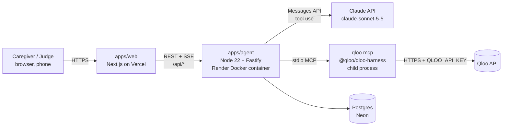

# 04 · Architecture & Tech Stack

## 1. System diagram

- Browser **never** talks to Qloo or Claude directly. Keys live only in the agent container.
- Frontend calls agent service via `NEXT_PUBLIC_AGENT_URL`; agent restricts CORS to the web origin.

## 2. Tech stack (use latest stable versions at scaffold time; pin in lockfile)
| Layer | Choice | Why |
|---|---|---|
| Monorepo | pnpm workspaces (plain `pnpm -r` scripts, no Turborepo) | shared types, one repo for judges |
| Language | TypeScript strict everywhere | fewer bugs, shared types |
| Frontend | Next.js (App Router), React, Tailwind CSS, shadcn/ui (Radix), lucide icons | fast, accessible components |
| Forms/validation | react-hook-form + zod | shared zod schemas with backend |
| Data fetching | `fetch` + a small SSE reader (`lib/sse.ts`) | streaming agent progress; EventSource can't POST or send the bearer header |
| Backend | Node ≥ 22.19, Fastify, zod; built with tsup into one self-contained `dist/server.cjs` | light, fast, long-lived process for MCP; tiny runtime image |
| Qloo | `@qloo/qloo-harness` (global in container) + `@modelcontextprotocol/sdk` client | official route |
| LLM | `@anthropic-ai/sdk`, model `claude-sonnet-5-5` (cost/speed); optionally `claude-opus-5-5` for compose step | strong tool use |
| DB | Postgres + Drizzle ORM + drizzle-kit migrations | simple, typed |
| Cache | Postgres table `qloo_cache` (no Redis needed) | fewer moving parts |
| Rate limit | `@fastify/rate-limit` + DB daily budget counter | quota safety |
| Testing | Vitest (unit) with synthetic Qloo envelopes (committed) + locally recorded fixtures (gitignored — no Qloo response data in the public repo); store SQL tested on PGlite (in-process Postgres) with the real migrations; Playwright (2–3 e2e smoke flows) | reliability |
| Migrations | drizzle-kit generates SQL into `apps/agent/drizzle/` (`db:generate`); the agent applies them at startup (failure is logged by code, agent keeps serving) | no manual DB steps on deploy |
| Lint/format | ESLint + Prettier | consistency |
| CI | GitHub Actions: typecheck, lint, test | judges see quality |
| Hosting | Vercel (web), **Render free** (agent, `apps/agent/Dockerfile` via `render.yaml`), **Neon free** (DB); all US East | MCP needs a container; all free. Render free sleeps after 15 min idle → UptimeRobot 5-min keep-alive on `/api/health/live` (750 free h/month covers 24/7; touches no DB). Readiness monitor on `/api/health` only **hourly**, because Neon free has ~100 CU-h/month and a 5-min DB ping would keep it awake 24/7 |
| Observability | pino logs (redacted), simple `/api/health` | debugging |

**Note:** Claude Code Max plan pays for *building* with Claude Code. The deployed app's own LLM
calls need a separate **Anthropic API key** (Console billing). Budget it; cache aggressively.

## 3. Repo layout
```
memory-lane/
├─ CLAUDE.md                  # master rules for Claude Code
├─ README.md                  # judge-facing (template in docs/10)
├─ LICENSE                    # MIT
├─ .mcp.json                  # Claude Code dev access to `qloo mcp` (no secrets)
├─ .claude/agents/*.md        # project subagents
├─ .env.example
├─ docs/                      # this pack + qloo-findings.md + progress.md
├─ apps/
│  ├─ web/                    # Next.js
│  │  └─ src/app/{page,demo,profiles/new,profiles/[id],sessions/[id],compare/[id],how-it-works}
│  └─ agent/
│     ├─ Dockerfile           # node:22 + npm i -g @qloo/qloo-harness (build context = repo root)
│     └─ src/
│        ├─ server.ts         # Fastify routes
│        ├─ qloo/{mcpClient,gateway,redact,cache}.ts
│        ├─ agent/{orchestrator,prompts,tools,validators,baseline}.ts
│        ├─ db/{schema,client,migrations}
│        └─ seed/demoPersonas.ts
└─ packages/shared/src/{schemas,types}.ts   # zod schemas = single source of truth
```

## 4. Data model (Drizzle / Postgres)
| Table | Key columns |
|---|---|
| `profiles` | id (uuid), owner_token_hash (sha256 of the device's owner token), nickname, birth_year, languages[], life_stages jsonb [{region, from_year, to_year}], is_demo bool, created_at |
| `seeds` | id, profile_id, raw_text, domain (music/film/tv/food/place/other), qloo_entity_id, qloo_entity_type, display_name, status (pending/needs_input/confirmed/rejected/unresolved, CHECK), note (not_found/no_clear_match/personal_info/invalid/lookup_failed: why it wasn't matched, shown as fixed text), source (caregiver/learned), evidence_id (FK → qloo_calls; CHECK: confirmed ⇒ evidence_id + qloo_entity_id) |
| `seed_candidates` | seed_id (cascade), position, entity_id, name, entity_type (raw Qloo type URN), year, description (one line from Qloo), evidence_id (not null, FK → qloo_calls): the matches Stage 1 found; confirm only accepts one of these, then the seed's candidates are deleted |
| `avoid_items` | id, profile_id, text, qloo_entity_id nullable, reason, source (caregiver/learned) |
| `taste_profiles` | id, profile_id (cascade), version (unique per profile; the newest is shown), era_from, era_to, partial, items jsonb (`TasteItemSchema`: domain, entityId, entityType URN, typeLabel, name, year, description, caption, source favourite/qloo, becauseOf[], evidenceIds[]), notes jsonb, created_at |
| `sessions` | id, profile_id, number, status (planned/in_progress/done), plan jsonb, what_changed text, created_at |
| `session_items` | id, session_id, order, kind (song/film/food/place/tv/other), qloo_entity_id, title, why text, prompts text[], link_url, evidence_ids[] |
| `reactions` | id, session_item_id, value (engaged/sang/neutral/distressed), note, created_at |
| `qloo_calls` | id, profile_id nullable (cascade on profile delete), tool, args_checked jsonb (as sent, after the PII guard), status, summary, result_count, results_digest jsonb, cached bool, latency_ms, created_at |
| `qloo_cache` | key (sha256), tool, args jsonb, envelope jsonb, expires_at |
| `budget` | day, qloo_calls, llm_tokens, profiles_created |

Auth: **no login**. The agent mints a random owner token (32 bytes, base64url) with the first profile;
the web keeps it on the device (localStorage, memory fallback) and sends `Authorization: Bearer …`. Only
sha256(token) is stored. A bearer header, not a cookie: agent (onrender.com) and web (vercel.app) are
different sites, so an agent cookie would be third-party and blocked by Safari/Firefox/Brave. Non-owners
get 404. Demo personas are public read-only (`is_demo`, never deletable), "Duplicate to try changes"
creates an owned copy. Seeds and avoid items cascade on profile delete.
Client IP for rate limits = `CLIENT_IP_HEADER` (only `cf-connecting-ip` / `true-client-ip`; Render:
`cf-connecting-ip`, which Cloudflare always overwrites and refuses from clients), else `req.ip`; IPv6 is
keyed per /64. Tokens are only reused if they already own a profile (clients can't choose tokens); demo
profiles get an owner hash no token can produce. Limits: 20 profiles per owner, 200 per day overall
(`budget.profiles_created`), retention 90 days via `profiles.last_seen_at` + a daily purge.

## 5. API (agent service)
| Method & path | Purpose |
|---|---|
| GET `/api/health/live` | liveness only, always 200 (Render health-check path, so deploys succeed while Qloo/DB aren't ready) |
| GET `/api/health` | readiness: agent + `qloo_capabilities` (`adapter.ready`) + DB `select 1`; 200 when all ok, 503 when degraded; body = `HealthResponseSchema` |
| GET `/api/demo-profiles` | list seeded personas |
| POST `/api/profiles` | create profile (shared zod schema); mints an owner token if the request has none; 10/hour/IP |
| GET `/api/profiles` | the caller's profiles (by owner token) |
| GET `/api/profiles/:id` | profile + seeds (+ taste profile + sessions later); owner or demo, else 404 |
| DELETE `/api/profiles/:id` | owner only; cascades seeds/avoid items (docs/07 §2.8) |
| GET `/api/profiles/:id/seeds` | owner only: each favourite's status + stored candidates |
| POST `/api/profiles/:id/seeds/resolve` | owner only, SSE, 6/min/IP, one run per profile (else 409 `already_checking`): looks up each pending favourite with `qloo_describe` → stored candidates (status `needs_input`) or `unresolved` + note; stops at the first failure, no key, quota or used-up allowance (`error` event; that seed stays pending). Allowance: `STAGE1_LOOKUPS_PER_OWNER_DAY` (50) per device token and `STAGE1_LOOKUPS_PER_CLIENT_DAY` (100) per client IP, in memory; Stage 1 leaves `QLOO_BUDGET_RESERVE` (100) of the daily budget for demo personas (gateway `reserve`). Keep-alive comment every 15 s |
| POST `/api/profiles/:id/seeds/confirm` | owner only, 30/min/IP: `{decisions:[{seedId, candidateId \| null}]}`; a candidate must be one stored for that seed (else 409 `choice_out_of_date`); null = "None of these" → `rejected` |
| GET `/api/profiles/:id/taste-profile` | owner only: the newest Life Taste Profile, or null |
| POST `/api/profiles/:id/taste-profile` | owner only, SSE, 4/min/IP: Stage 2 builds a new version (`TasteEventSchema`); 409 `nothing_confirmed` before any favourite is confirmed; shares the research allowance and the per-profile run lock with Stage 1 |
| POST `/api/profiles/:id/sessions` | SSE: agent composes next session (uses reactions history) |
| GET `/api/sessions/:id` | session + items |
| POST `/api/session-items/:id/reaction` | log reaction |
| POST `/api/sessions/:id/complete` | SSE: adapt step → `what_changed` + learned seeds/avoids |
| GET `/api/profiles/:id/compare` | baseline (LLM-only) vs grounded plan (cached) |
| GET `/api/evidence/:id` | owner of the profile it was made for only: tool, args (as sent, after the PII guard), status, result count, cached, time — never the harness summary |

SSE event shape: `{type:"step"|"tool"|"result"|"error"|"done", message, tool?, status?, evidenceId?, data?}`.
Messages are fixed app text; harness `summary`/`recovery` text is never forwarded. Stage 1 events are
`ResolveEventSchema` in `packages/shared/src/resolve.ts` (`error` carries `problem`:
`qloo_not_connected` | `quota` | `unavailable`; the stream always ends with `done`).

Local demo without secrets: `pnpm --filter @memory-lane/agent dev:fixtures` (in-memory PGlite +
synthetic Qloo envelopes from `test/fixtures`). Both switches are refused when `NODE_ENV=production`, and
PGlite stays out of the production bundle.

## 6. Non-functional requirements
- p95 cached demo load < 3 s; uncached session build target < 45 s with live progress.
- Every failure path shows a human message + retry; never a blank screen.
- Accessibility: WCAG AA contrast, keyboard navigable, base font ≥ 18 px in player.
- Security: secrets only in env; CORS allow-list; input size limits; helmet headers; no PII in logs.
- Keep the hosted app up until ≥ Nov 17; free UptimeRobot: 5-min keep-alive on `/api/health/live` +
  hourly readiness check on `/api/health`.
- Agent hardening (Phase 1): Qloo harness gets an allow-listed env only; DB TLS `verify-full` in
  production; global error handler never echoes 5xx error text; readiness cached 10 s; `WEB_ORIGIN`
  required (exact https origins) in production.
