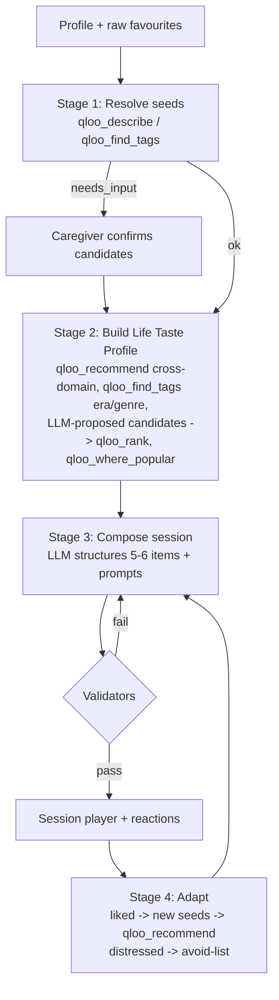

# 05 · Agent Design (the heart of the project)

## 1. Design principle
**"LLM proposes, Qloo decides, code verifies."**
- Claude (LLM) is good at language, empathy, structuring a session and proposing candidates.
- Qloo is the source of truth for *what culturally fits* (resolution, affinity, ranking, region).
- Deterministic code (validators) guarantees: every item has Qloo evidence, nothing violates the
  avoid-list, no personal data reaches Qloo.

This is a **hybrid orchestrator**: fixed stages (reliable, demo-safe) with an agentic tool-use
loop *inside* each stage (flexible, visibly agentic).

## 2. Stages


### Stage 1 — Resolve seeds
- Input: raw favourites text + domain hints.
- Tools: `qloo_describe` for singers, films, TV and places (type from the wizard domain);
  `qloo_find_tags` for food and "something else" (dishes and interests are tags in Qloo, not entities).
- Output: per seed → `needs_input` with up to 5 stored candidates (each with an evidence id), or
  `unresolved` (nothing found, or refused by the PII guard). The caregiver then confirms **every** seed,
  single matches included: a single match is preselected, never auto-confirmed. "None of these" →
  `rejected`. No key / quota / outage → the seed stays `pending` and the UI says so; nothing is guessed.
  The run stops at the first failed lookup (the rest would most likely fail too and spend budget); that
  seed keeps the note `lookup_failed`. Stage 1 writes only touch seeds that are still `pending`.
- Rule: **never** use an unconfirmed seed downstream. UI shows candidates with name · type · year and
  Qloo's one-line description (what tells namesakes apart).
- Candidates (pinned against local recordings, 2026-10-13; `stage1/mapDescribe.ts`, `mapFindTags.ts`):
  describe returns a selected entity + "alternatives". Exact match → selected + same-name, same-type
  alternatives only (the rest is fuzzy noise, e.g. WALL·E for Mughal-e-Azam). Non-exact matches and
  **places** → all same-type alternatives (Phase 0: "Golden Temple" matched exactly to a temple in another
  city). find_tags → one candidate per distinct name; food keeps food tags only, preferring cuisine.
  The raw Qloo type URN is stored (`urn:entity:artist`, `urn:tag:cuisine:qloo`) so Stage 2 knows entity
  vs tag; labels ("film", "dish") are display only.

### Phase 0 findings that shape Stages 2–4 (details: docs/qloo-findings.md)
- Stage 2 calls Qloo with **confirmed entity IDs** (`signals`) and tag URNs (`signal_tags`), never names:
  bare names are ambiguous across types (needs_input).
- **No era filter exists** (decade tags match films *set* in an era; `demographic` age bands are dropped).
  Era comes from: artist→artist recommends (≈9/10 era-correct), a **code validator on `release_year`**
  against the person's window (≈ birth year + 5 … + 40) for films/TV, and `qloo_rank` of LLM-proposed
  candidates (era names rank first with a clear gap).
- Domain order by data quality: music (spine) → TV → film → places → food. Food items carry **tag
  evidence** (cuisine tags) and become conversation prompts, labelled honestly; tag-only place
  recommends are junk.
- Places: resolve named landmarks, then `filter_location` with a coarse city; `where_popular` returns only
  geohash cells, so it is not shown.
- Avoid-list validation must also read Qloo descriptions (some films touch war/trauma themes).
- The gateway runs ≤3 live calls at once (bursts of 8 hit a 429).

### Stage 2 — Life Taste Profile (built: `apps/agent/src/stage2/`)
A fixed, visible plan of 5 Qloo calls in parallel (≤3 at once), from the confirmed seeds' **entity IDs**:
1. **Music** — `qloo_recommend` artist (signals = up to 5 seed IDs, artists first, `explain`). Singers whose
   Qloo description centres inside the reminiscence bump come first, unknown dates keep Qloo's order,
   mostly-later voices only fill in (`era.ts` `eraPlacement`).
2. **Films and TV** — `qloo_recommend` movie + tv_show (limit 20): only `release_year` within birth +5 … +45,
   closest to the bump (birth +10 … +30) first.
3. **Places** — `qloo_recommend` place, `filter_location` = the earliest life-stage region, signals = the
   confirmed places (else all seeds). Kept: lasting places (landmarks, markets, parks, the seaside: name +
   opening words of Qloo's description), not hotels/bars/banquet halls, in the same country as most
   results (Qloo's filter crossed to Wagah, Pakistan), not sites of grief.
4. **Food** — favourites (cuisine tags) + `qloo_find_tags` "<town> food" (food tags only, near-duplicate
   names merged).
Every Qloo item is checked against the avoid-list (name + Qloo's full description, with related words
for well-known painful topics: "Partition" also keeps out Wagah/1947/refugees) and a gentle filter
(atrocities, suicide, abuse), then the validators (grounding, avoid, language) before saving.
Captions use Qloo's own explanation: "People who enjoy X and Y often also enjoy Z." Up to 6 items per
domain; favourites first. Live results (2026-10-13) for the three personas: era-correct music (Kishore
Kumar, Mukesh / The Kinks, Roy Orbison / The Platters), films such as Guide (1965) and Deewaar (1975),
places such as Gobindgarh Fort, Sadda Pind, Carillon Historical Park.
**With the Claude key (next):** `propose_candidates` adds era-typical names per domain, which only
survive through `qloo_rank` / `qloo_describe` with evidence (Phase 0: rank pushes modern names down).

### Stage 3 — Compose session
- Mostly LLM (structured JSON output, zod-validated) using ONLY items from the taste profile (plus
  learned seeds). It may NOT introduce new entities — if it wants one, it must go back through
  Qloo (tool call) to get evidence.
- Session template (20–30 min): opener song → film/TV memory → food & senses → place/journey →
  "your choice" (best-reacted domain) → closing song.
- Per item: `why` (1 sentence, aggregate wording, referencing evidence), 2–3 prompts (open,
  gentle, never quiz-like), `link_url` (YouTube/Spotify search URL built in code, not by LLM).

### Stage 4 — Adapt
- Inputs: reactions of the last session(s).
- `sang`/`engaged` items → become `learned` seeds → `qloo_recommend` for neighbours.
- `distressed` → avoid-list (entity + related tags), explained to caregiver.
- `neutral` → de-prioritise that sub-genre/domain.
- Output: `what_changed` (3 bullet sentences shown to caregiver) + next session.

## 3. Validators (code, run before anything is shown)
1. **Grounding:** every item has ≥1 `evidence_id` whose envelope status ∈ {ok, partial, degraded}
   and whose results contain that entity. Else reject → regenerate (max 2) → drop item.
2. **Avoid-list:** no item matches avoid entity IDs, avoid tags, or avoid keywords (case-insensitive).
3. **Language policy:** `why` text must use aggregate phrasing; block patterns like
   "she loved", "he will enjoy", "this will help his dementia", "treat", "cure", "therapy for".
4. **Prompt safety:** prompts must not ask test-like recall questions ("Do you remember…?" is
   discouraged → prefer "What was it like when…", "Tell me about…"). Lint with regex list.
5. **PII guard (pre-Qloo):** args contain no nickname, no exact addresses/emails/phones, no
   health terms. Implemented in `qloo/redact.ts`, unit-tested.

## 4. Prompts (starting drafts — keep in `apps/agent/src/agent/prompts.ts`)

### 4.1 System prompt — taste-profile stage
```
You are Memory Lane's cultural research agent. You help caregivers prepare personalised
reminiscence sessions for an older adult. You MUST ground every cultural item in Qloo tool results.

Rules:
- Use only public cultural signals with Qloo tools: confirmed seed entities, genre/era tags, coarse
  regions, decades, target entity types. Never send the person's nickname or any health detail.
- You may propose candidate entities from your own knowledge ONLY via the propose_candidates tool;
  candidates are worthless until resolved (qloo_describe) and ranked (qloo_rank) or found via
  qloo_recommend.
- If a tool returns needs_input, stop and return the candidates for the caregiver.
- If a tool returns empty, refine once; then move on. Never fill gaps with unverified items.
- Respect the avoid-list absolutely.
- Aim for 4 domains (music, film_tv, food, places) x 4-6 items. Stop when done or budget is hit.
- Final answer: JSON matching TasteProfileSchema with evidence_ids for every item.
```

### 4.2 System prompt — compose stage
```
You are Memory Lane's session designer. Build one 20-30 minute reminiscence session from the
provided Taste Profile items only. You cannot add new entities.

Write with warmth and dignity. Prompts are open, gentle invitations ("Tell me about...", "What was it
like when..."), never memory tests. Captions use aggregate language ("People who grew up with X often
enjoyed Y"), never claims about this person. Never mention treatment, therapy outcomes, or dementia
severity. Follow the session template. Output JSON matching SessionPlanSchema.
```

### 4.3 Baseline prompt (for "Without Qloo" compare — same model, NO tools)
```
Plan a 20-30 minute reminiscence session (5-6 items: songs, films, food, places) for an older adult
born in {birth_year}, who lived in {regions}, speaks {languages}, and liked {seed names}.
Return JSON matching SessionPlanSchema (no evidence fields).
```
Compare view shows: items side by side, **grounded count** (baseline = 0 evidence), and an
"overlap with other personas" metric (genericness) computed in code.

## 5. Tool definitions (our own app tools exposed to Claude)
| Tool | Input | Output |
|---|---|---|
| `propose_candidates` | `{domain, rationale, names: string[] (≤10)}` | echo list with ids `cand_*` (no data) — forces next step to resolve |
| `get_profile_context` | `{}` | birth decade, coarse regions, languages, confirmed seeds, avoid-list (no nickname) |
| `get_reaction_history` | `{last_n_sessions}` | items + reactions |

Qloo tools are passed through from `listTools()` but **filtered** by the gateway allow-list per stage.

## 6. Budgets & reliability
- Per stage: max tool calls (Stage 2: 12, Stage 4: 6), max LLM tokens, wall clock 60 s.
- On budget hit → return best partial result + note "partial" (never crash).
- Use Claude **prompt caching** for system prompts + tool definitions.
- Record/replay: in tests, a fake MCP client (`qloo/fixtureMcp.ts`) feeds the real gateway synthetic
  envelopes from `apps/agent/test/fixtures/synthetic/` (committed). Real recordings live only locally in gitignored `apps/agent/test/fixtures/recorded/`, because
  Qloo's guide forbids storing Qloo response data in a public repository.

## 7. What judges should notice (call out in README)
1. Real tool chain (resolve → confirm → recommend/rank → compose → validate → adapt).
2. Human-in-the-loop on ambiguity (`needs_input`).
3. Evidence on every item + compare view.
4. Learning loop across sessions.
5. Responsible data handling (no PII to Qloo, aggregate language).
