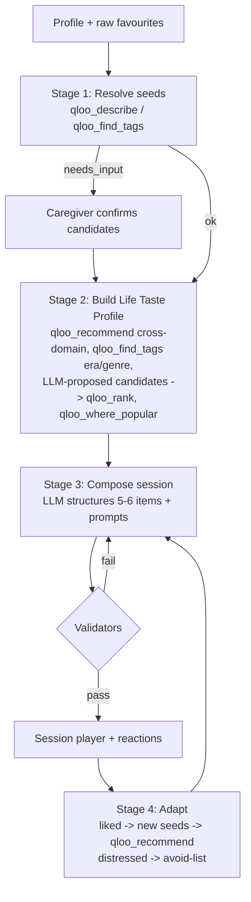

# 05 · Agent Design (the heart of the project)

## 1. Design principle
**"LLM proposes, Qloo decides, code verifies."**
- Claude (LLM) is good at language, empathy, structuring a session and proposing candidates.
- Qloo is the source of truth for *what culturally fits* (resolution, affinity, ranking, region).
- Deterministic code (validators) guarantees: every item has Qloo evidence, nothing violates the
  avoid-list, no personal data reaches Qloo.

This is a **hybrid orchestrator**: fixed stages (reliable, demo-safe) with an agentic tool-use
loop *inside* each stage (flexible, visibly agentic).

## 2. Stages


### Stage 1 — Resolve seeds
- Input: raw favourites text + domain hints.
- Tools: `qloo_describe`, `qloo_find_tags`.
- Output: per seed → `confirmed` (single clear match), `candidates` (needs_input / several close),
  or `unresolved`.
- Rule: **never** use an unconfirmed seed downstream. UI shows candidates with name/type/year.

### Stage 2 — Life Taste Profile
Agent loop (max ~12 tool calls, budget-guarded). Allowed tools: `qloo_recommend`, `qloo_rank`,
`qloo_find_tags`, `qloo_describe`, `qloo_where_popular`, `qloo_entity_tags`,
`qloo_audience_demographics`, plus app tool `propose_candidates` (returns LLM candidates as a list
that must then be resolved & ranked).
Target: 4 domains × 4–6 items, each with `evidence_ids`.

### Stage 3 — Compose session
- Mostly LLM (structured JSON output, zod-validated) using ONLY items from the taste profile (plus
  learned seeds). It may NOT introduce new entities — if it wants one, it must go back through
  Qloo (tool call) to get evidence.
- Session template (20–30 min): opener song → film/TV memory → food & senses → place/journey →
  "your choice" (best-reacted domain) → closing song.
- Per item: `why` (1 sentence, aggregate wording, referencing evidence), 2–3 prompts (open,
  gentle, never quiz-like), `link_url` (YouTube/Spotify search URL built in code, not by LLM).

### Stage 4 — Adapt
- Inputs: reactions of the last session(s).
- `sang`/`engaged` items → become `learned` seeds → `qloo_recommend` for neighbours.
- `distressed` → avoid-list (entity + related tags), explained to caregiver.
- `neutral` → de-prioritise that sub-genre/domain.
- Output: `what_changed` (3 bullet sentences shown to caregiver) + next session.

## 3. Validators (code, run before anything is shown)
1. **Grounding:** every item has ≥1 `evidence_id` whose envelope status ∈ {ok, partial, degraded}
   and whose results contain that entity. Else reject → regenerate (max 2) → drop item.
2. **Avoid-list:** no item matches avoid entity IDs, avoid tags, or avoid keywords (case-insensitive).
3. **Language policy:** `why` text must use aggregate phrasing; block patterns like
   "she loved", "he will enjoy", "this will help his dementia", "treat", "cure", "therapy for".
4. **Prompt safety:** prompts must not ask test-like recall questions ("Do you remember…?" is
   discouraged → prefer "What was it like when…", "Tell me about…"). Lint with regex list.
5. **PII guard (pre-Qloo):** args contain no nickname, no exact addresses/emails/phones, no
   health terms. Implemented in `qloo/redact.ts`, unit-tested.

## 4. Prompts (starting drafts — keep in `apps/agent/src/agent/prompts.ts`)

### 4.1 System prompt — taste-profile stage
```
You are Memory Lane's cultural research agent. You help caregivers prepare personalised
reminiscence sessions for an older adult. You MUST ground every cultural item in Qloo tool results.

Rules:
- Use only public cultural signals with Qloo tools: confirmed seed entities, genre/era tags, coarse
  regions, decades, target entity types. Never send the person's nickname or any health detail.
- You may propose candidate entities from your own knowledge ONLY via the propose_candidates tool;
  candidates are worthless until resolved (qloo_describe) and ranked (qloo_rank) or found via
  qloo_recommend.
- If a tool returns needs_input, stop and return the candidates for the caregiver.
- If a tool returns empty, refine once; then move on. Never fill gaps with unverified items.
- Respect the avoid-list absolutely.
- Aim for 4 domains (music, film_tv, food, places) x 4-6 items. Stop when done or budget is hit.
- Final answer: JSON matching TasteProfileSchema with evidence_ids for every item.
```

### 4.2 System prompt — compose stage
```
You are Memory Lane's session designer. Build one 20-30 minute reminiscence session from the
provided Taste Profile items only. You cannot add new entities.

Write with warmth and dignity. Prompts are open, gentle invitations ("Tell me about...", "What was it
like when..."), never memory tests. Captions use aggregate language ("People who grew up with X often
enjoyed Y"), never claims about this person. Never mention treatment, therapy outcomes, or dementia
severity. Follow the session template. Output JSON matching SessionPlanSchema.
```

### 4.3 Baseline prompt (for "Without Qloo" compare — same model, NO tools)
```
Plan a 20-30 minute reminiscence session (5-6 items: songs, films, food, places) for an older adult
born in {birth_year}, who lived in {regions}, speaks {languages}, and liked {seed names}.
Return JSON matching SessionPlanSchema (no evidence fields).
```
Compare view shows: items side by side, **grounded count** (baseline = 0 evidence), and an
"overlap with other personas" metric (genericness) computed in code.

## 5. Tool definitions (our own app tools exposed to Claude)
| Tool | Input | Output |
|---|---|---|
| `propose_candidates` | `{domain, rationale, names: string[] (≤10)}` | echo list with ids `cand_*` (no data) — forces next step to resolve |
| `get_profile_context` | `{}` | birth decade, coarse regions, languages, confirmed seeds, avoid-list (no nickname) |
| `get_reaction_history` | `{last_n_sessions}` | items + reactions |

Qloo tools are passed through from `listTools()` but **filtered** by the gateway allow-list per stage.

## 6. Budgets & reliability
- Per stage: max tool calls (Stage 2: 12, Stage 4: 6), max LLM tokens, wall clock 60 s.
- On budget hit → return best partial result + note "partial" (never crash).
- Use Claude **prompt caching** for system prompts + tool definitions.
- Record/replay: in tests, a `FixtureGateway` serves recorded envelopes from `apps/agent/test/fixtures/`.

## 7. What judges should notice (call out in README)
1. Real tool chain (resolve → confirm → recommend/rank → compose → validate → adapt).
2. Human-in-the-loop on ambiguity (`needs_input`).
3. Evidence on every item + compare view.
4. Learning loop across sessions.
5. Responsible data handling (no PII to Qloo, aggregate language).
